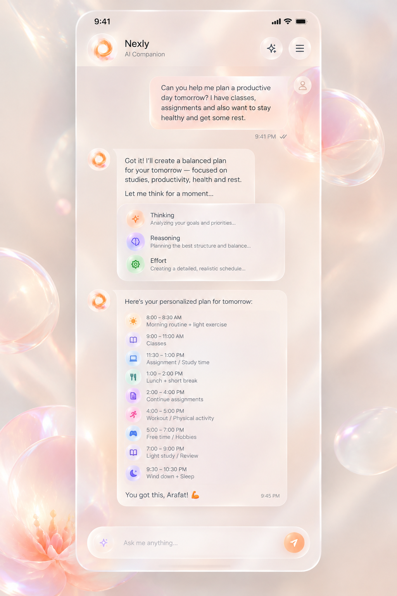

# Nexly native response — north star

This is the durable brief for the assistant-response slice. It exists so the
goal survives context compaction and hand-offs. Read it before changing chat
rendering, the plan contract, or the glass icon system.

## The one reference



The target is the glass-card conversation in that image, on **Android and iOS
native only**. The website is not the deliverable. Another agent owns the Home
page; do not edit Home.

## What the reference is

- Warm pearlescent backdrop with translucent orbs and a soft lotus.
- A brand header: companion orb, “Nexly / AI Companion”, a sparkle control and
  a menu control. No tiled navigation title.
- User turn: pale translucent peach bubble, ~24 radius, dark text, avatar on
  the right, time + double delivery tick underneath.
- Assistant turn: an orb **outside** a milky glass card; the preamble is prose
  inside the card. No “GS” label inside the message.
- Thinking card: a three-row glass panel after the preamble —
  Thinking / Reasoning / Effort with the reference subtitles and **circular**
  pastel glass tiles. It stays visible through reasoning and the answer, not
  only before the first token. The reference copy is for plan turns; every
  other turn uses honest, task-neutral copy and the backend's real effort,
  with a thin halo on the active row. A flash turn with no reasoning does not
  show a fake thinking card.
- Plan card: one glass card with a title, 5–9 timed rows (time over activity),
  a circular pastel glass icon on every row, a closing encouragement and a
  timestamp at the trailing edge.
- Composer: one glass capsule with a lilac sparkle at the left, the placeholder
  “Ask me anything…”, and a peach paper-plane send control at the right.
  Attach/mode/voice live behind the sparkle, not as extra chrome.
- Airy spacing (~20dp between turns), glass on header, user bubble, assistant
  cards, thinking card and composer.

## The model-facing contract

The model must answer a schedule/routine/itinerary request with exactly one
fenced `plan` block, never a markdown table or bullet list:

````text
Got it! I'll create a balanced plan for your tomorrow.

Let me think for a moment...

```plan
{
  "title": "Here's your personalized plan for tomorrow:",
  "rows": [
    { "time": "8:00 – 8:30 AM", "icon": "sunrise", "tone": "amber", "text": "Morning routine + light exercise" }
  ],
  "closing": "You got this, Arafat!",
  "closingIcon": "flame",
  "timestamp": "9:45 PM"
}
```
````

Rules enforced by the renderer, not just the prompt:

- `rows` is capped at 14; a row without a time and text is dropped.
- `rows`, `items`, or a `plan`/`schedule`/`timetable` wrapper are accepted;
  `time`/`start`/`from`/`date`/`slot` and
  `text`/`label`/`title`/`activity`/`detail`/`task` are accepted synonyms.
- The icon is a Tabler kebab-case name from the shared registry. An unknown
  name falls back to `sparkles`; aliases such as `study` resolve to `book-2`.
- Emoji is banned in the prompt and stripped (or converted to `:icon:` tokens)
  by every renderer. Inline `:sunrise:` tokens become real glyphs.
- The plan is a first-class block (`Block.PlanBlock` on Android,
  `Block.plan` on iOS), rendered outside the prose card, with its own glass.
  A malformed or JSON-wrapped payload degrades to code, never an empty card.
- The chat shell keeps the Thinking card for a settled plan turn and suppresses
  the duplicate footer timestamp because the plan card owns the stamp.

The prompt lives in `src/lib/nexly/plan.ts` (`NEXLY_PLAN_PROMPT`), is appended
to the live `WIDGET_PROMPT` in `src/lib/widgets/prompt.ts`, and therefore
reaches the model through `src/lib/turn-executor.ts`. The shared widget
catalogue, validator and web registry also know the `plan` kind.

## The icon system

- **5,184** web SVG symbols: `public/icons/gs-sprite.svg` + name manifest in
  `src/lib/nexly/icon-names.json`.
- **5,247** native glyph names, one outline font, identical map on both
  clients: `android/app/src/main/res/font/tabler_icons.ttf`,
  `android/app/src/main/assets/nexly-icons.json`, iOS
  `App/Resources/TablerIcons.ttf` and `nexly-icons.json`.
- `NEXLY_ICON_GUIDE` in `src/lib/nexly/icons.ts` is the compact model-facing
  vocabulary (14 semantic groups, 130+ exact names). Every entry is validated
  by `scripts/test-nexly-plan.ts`; every native codepoint is present in the
  font cmap.
- Eight glass tones; the tile carries the colour and the glyph is white, as in
  the reference. Native tiles use a tone-coloured halo, a white rim and a
  top-left airlight.

## Hard constraints for this slice

- Native only: Android + iOS. Do not redesign the Home page; another agent owns
  it.
- No commits, pushes, or native builds while the work is in progress. The user
  will direct the final CI pass (GitHub Actions is available for that).
- No credentials in the repository. The GitHub token pasted in chat is not
  recorded here.
- Static verification is not a render. Android has no SDK/Gradle 8.13 here and
  iOS has no Xcode; the native tests added in this slice must run in CI.

## Current status (this pass)

- Compile blocker fixed: Android `ContentFixtures.summarize` now handles
  `Block.PlanBlock` (the sealed `when` was non-exhaustive).
- Plan parser hardened on web, Android and iOS (wrappers + synonyms).
- Plan inference now requires **timed rows**, so tables/label lists are not
  stolen by the timetable renderer.
- Natural fence names (`schedule`, `timetable`, `itinerary`, `routine`, `day`)
  canonicalise to `plan` only when the payload has timed rows; a real
  interactive `schedule` app still routes to `app`.
- Native plan detection no longer relies on the literal ` ```plan ` substring;
  promoted plans keep the Thinking card and avoid a duplicate timestamp.
- Glyph ink corrected to white on both native platforms; avatar glyph matched.
- Reference icon tones are pinned even when the model omits `tone` (sunrise
  amber, study lavender, work blue, food green, movement pink, sleep lilac);
  the prompt now teaches the same mapping.
- Android backdrop now carries the lower-left lotus like iOS.
- The Thinking card is state-driven on both platforms: the backend mode event
  now carries `effort`; clients parse `effectiveMode` + `effectiveEffort`; the
  phase follows the real stream (thinking → reasoning → answering); the active
  row gets a halo; plan turns keep the reference copy, other turns use
  task-neutral copy; flash turns with no reasoning hide the card.
- The full reference screen is rendered from production pieces on both
  platforms: the shared brand header, the real user message bubble/avatar/
  ticks, the assistant blocks, and the shared composer capsule.
- The rendered wire is a **real OpenRouter response** to a different real-life
  question (“I work a 9–5 shift tomorrow…”), captured with the production
  `SYSTEM_PROMPT + WIDGET_PROMPT`. It produced 9 timed rows, valid icons and no
  emoji. The prose render uses a second real question (thesis procrastination).
  Raw/final captures live in `docs/reference/nexly/live-*-real*.md`.
- The whole phone screen (header, user turn, preamble, Thinking card, all nine
  plan rows, closing, timestamp and composer) is visible at 393×852 and
  411×914. The column is capped at 640 and centered on tablets; the
  transcript scrolls on shorter devices while the composer stays on screen.
- Sheet-scale correction: the user turn is capped at **205pt on compact
  phones** (about half the device) with the avatar in its own lane; assistant
  cards are capped at **286pt prose / 290pt plan** (about 70% of a 393pt
  screen); the plan title is 12pt medium and one line at 393pt.
- The sheet's **soft neutral ink** replaced the app's near-black brown
  (`#4A4750` prose, `#555860` title, `#5E6068` rows, `#8C8E96` metadata).
- Glyph chips are now a **pale tone wash with the saturated colour in the
  glyph**, not saturated chips with white ink, and are **24pt with a 12pt
  glyph** so the emoji replacement reads at text scale, not as a giant icon.
- Plan rows are **actionable and logically wired**: every row has a trailing
  check ring; tapping fills it, strikes the row, reduces the tile tone and
  fires haptic feedback. Completion and a helpful/not-helpful rating are
  persisted per conversation, and the next message sends them as a non-visible
  `turnContext` (sanitised in `prepareTurn`), so the model can adapt.
- The activity card's third row is real: **Search** with a source count when
  research actually ran, otherwise **Answer**. Reasoning shows a trace only
  when one arrived; otherwise it says “Provider default reasoning”. The fixed
  “Effort” claim and the static “High effort” fixture are gone.
- The Android composer uses the iOS proportions: 38pt sparkle lane, 46pt
  capsule, 14pt field, 36pt send control.
- Flash is the default and no longer paints a Thinking/Reasoning card. The
  short non-thinking planner runs on every turn to choose answer, clarify or
  web search; a search runs before the answer in the same turn, and clarify
  options become native chips. Flash plan/prose evidence has no stage card.
- Fresh evidence: four live flash questions (Python comprehension, React
  effect, snoozing, interrupting a friend) are captured in
  `docs/reference/nexly/random-*.md`; the coding and snoozing answers render on
  both devices at 393×1400. The snoozing answer is a real model-authored plan.

- Cards use a thinner white veil, a hairline rim and almost no shadow. The
  backdrop draws defined pearl spheres (white rim, refraction band, specular
  crescent) and a stronger lotus in the lower-left.
- iOS landscape no longer pushes the composer below the screen edge: the
  harness pins the column to the geometry height, ignores the simulator safe
  area, and keeps the composer in flow.
- The user timestamp is 12-hour (`9:41 PM`) on both; the disabled send control
  stays peach rather than turning gray; plan/thinking spacing was compacted to
  the sheet's density.
- Tests added: `android/.../NexlyPlanTest.kt`,
  `android/.../NexlyPlanProgressStoreTest.kt`,
  `ios/App/Tests/AppTests/NexlyPlanTests.swift`,
  `ios/App/Tests/AppTests/NexlyPlanProgressStoreTests.swift`, expanded
  `scripts/test-nexly-plan.ts`, `F26_NEXLY_PLAN` fixtures on both parsers, and
  plan, adaptive-thinking, prose and full-screen renders on both platforms.
- **End-to-end capability proof** (branch server + SQLite, real route, run
  `39960319355`): an ambiguous “my code is not working” request produced a
  five-option clarify prompt and the choice was answered; a Bun-version
  question ran retrieval (8 sources) and, because the sources were irrelevant,
  the model refused to invent the version and pointed to the official releases
  page. Flash mode was `effective=flash`, and the planner ran on the turn.
  A second run (`39961095648`) sent `turnContext` with “Completed: Drink water;
  Open curtains” and the model answered exactly those two items, proving the
  checklist context reaches it. Evidence:
  `docs/reference/nexly/backend-capabilities.json` and
  `backend-capabilities-progress.json`.
- Native verification is green on commit `48daa550`: Android CI run
  `39955028622` (compile, Home render, Nexly response + adaptive + full-screen
  renders at the full size matrix, 281 unit tests) and iOS CI run
  `39955031934` (Xcode build, XCTest, Home render, the same Nexly renders).
  Evidence and run links are in `docs/reference/nexly/ci/README.md`.
