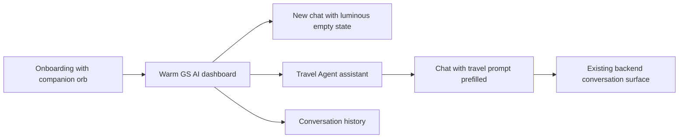

# GS AI reference UI blueprint

_Native Android and iOS frontend specification for the warm consumer AI experience._

---

## 🎨 Product direction

GS AI should feel like a calm, luminous companion rather than a utility dashboard. The reference language is a soft peach canvas, translucent cream surfaces, warm orange action color, oversized rounded geometry, and one living AI orb used as the emotional anchor.

The design is implemented as shared semantic tokens first, then composed into platform-native atoms and organisms. Backend contracts remain outside this layer.

## 🧱 Atomic structure

| Layer | Components | Native implementation |
| --- | --- | --- |
| Atoms | Orb, icon button, pill chip, progress meter, send button | `GsIcons`, `GsRadius`, `Aero` tokens |
| Molecules | Model selector, usage tile, reflection card, media action row | `HomeDashboardScreen.kt`, `HomeDashboardView.swift` |
| Organisms | Hero dashboard, onboarding step, Travel Agent message card, composer | Native Compose and SwiftUI screens |
| Templates | Onboarding shell, dashboard shell, assistant conversation shell | Route-level screens |

## 🌈 Visual tokens

| Token | Value | Intent |
| --- | --- | --- |
| Peach canvas | `#FFF4EF` | Main light background |
| Cream surface | `#FFFBF8` | Cards and composer surfaces |
| Soft coral | `#FFC7B1` | Secondary cards and glass tint |
| Orange action | `#F36F2C` | Generate, send, selected states |
| Ink | `#2B1A17` | Primary text |
| Muted clay | `#8F7169` | Secondary text |
| Card radius | `20dp / 20pt` | Feature tiles and message cards |
| Input radius | `26dp / 26pt` | Composer and primary CTA |

## 🔄 Native screen flow

The flow is intentionally short: the emotional onboarding creates the relationship, the dashboard exposes creation tools, and the Travel Agent demonstrates a specialized assistant without introducing a second backend model.

## ✨ Interaction rules

- Pressable cards use the existing native press style and settle quickly; no decorative animation is added to high-frequency typing or send actions.
- The orb is reserved for onboarding, empty-state identity, and assistant identity. It should not appear on every card.
- Hero surfaces can use a slow, low-amplitude breathing treatment only when the screen is idle and reduced-motion settings permit it.
- Cards enter at approximately `180–240ms` ease-out; drawers and route transitions use the existing spring behavior.
- The first onboarding tooltip is dismissible on any press and is never repeated in the same visit.

## ✅ Current implementation map

| Surface | Android | iOS |
| --- | --- | --- |
| Warm shared palette | `ui/theme/Color.kt`, `Tokens.kt` | `Theme/DesignSystem.swift` |
| Onboarding orb and shell | `ui/auth/OnboardingScreen.kt` | `Features/Auth/OnboardingView.swift` |
| Dashboard and usage meters | `ui/home/HomeDashboardScreen.kt` | `Features/Home/HomeDashboardView.swift` |
| Travel Agent | `ui/agents/TravelAgentScreen.kt` | `Features/Agents/TravelAgentView.swift` |
| Empty chat identity | `ui/chat/ChatScreen.kt` | `Features/Chats/ChatDetailView.swift` |

> This blueprint describes presentation only. It does not authorize changes to model routing, persistence, or backend APIs.
