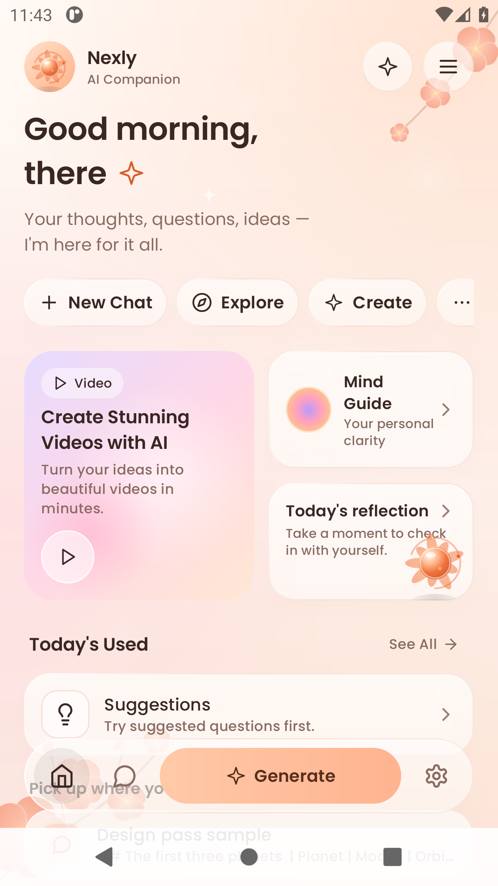
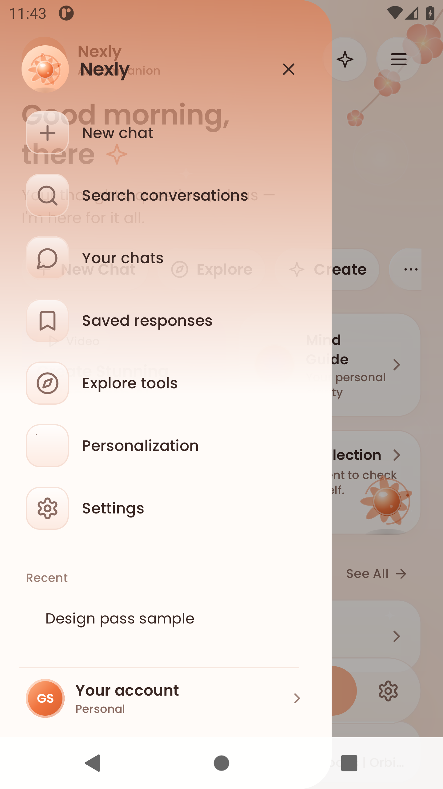
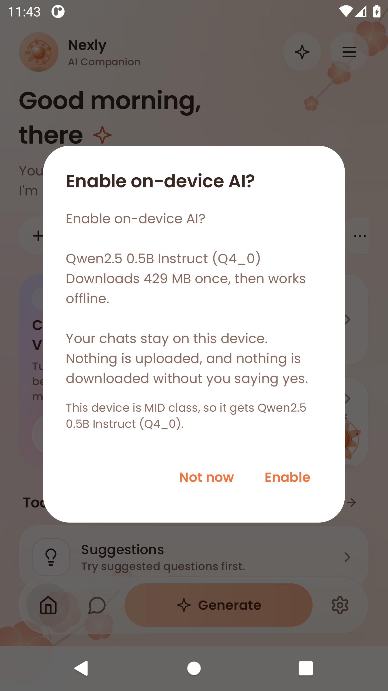
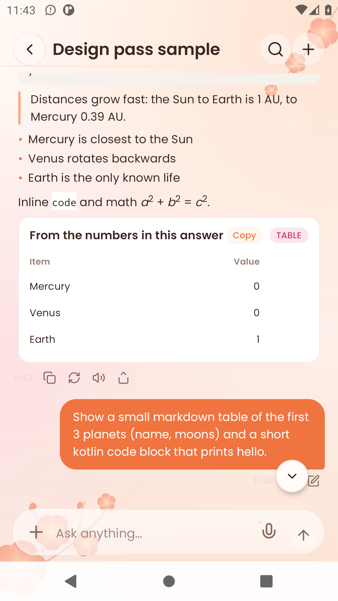
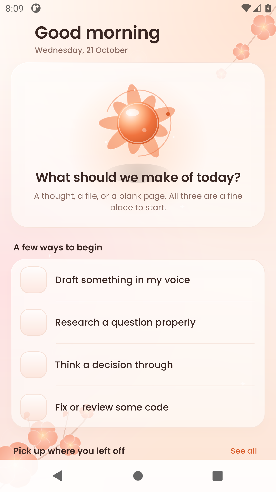
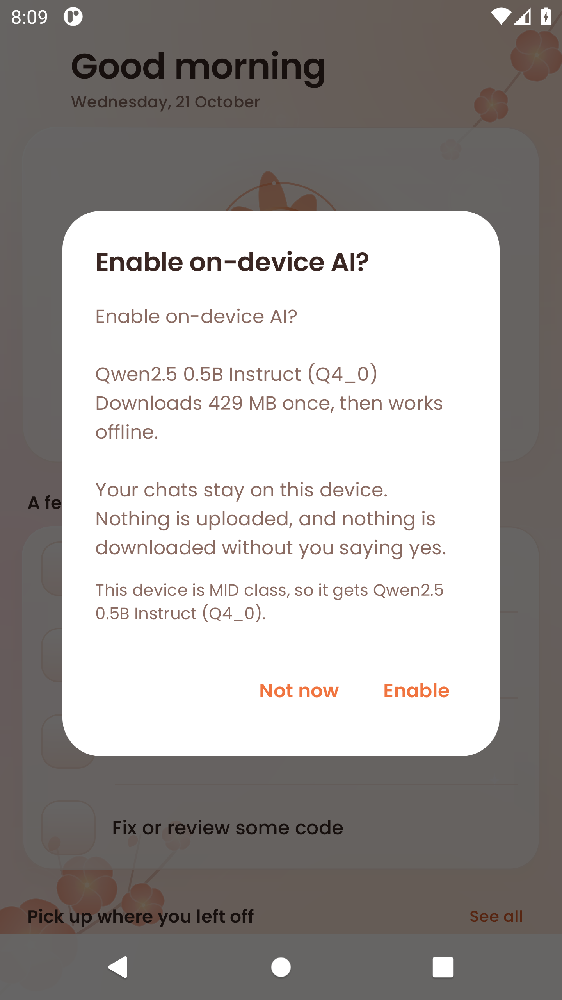

Here are all the generated files.

## Latest release: v0.83.0 — the Nexly reference redesign (versionCode 120)

    file    GS-AI-App.apk
    size    66238084 bytes
    sha256  59ea1cee74a13084ec6d9d79f7aad2e233e6fcd95c1578593e468930a9e363fc

The reference sheets, now built on `main`. Captured on the emulator from the
same revision the release APK builds from.

| Home — brand lockup, glass pills, bento, floating dock | Drawer — Nexly header, seven destinations, account footer |
|---|---|
|  |  |

| Onboarding — the reference welcome flow | Chat — rich reply rendering |
|---|---|
|  |  |

What landed: the invisible-icon defect is fixed (all 331 icon strokes were
transparent — the whole family now renders); interactive artifacts are tappable
again (charts no longer lose their taps to the message's text-selection
container); Home, the drawer, the Settings hub and the welcome flow are rebuilt
to the sheets; and the chat shows the reference's Thinking / Reasoning / Effort
pre-answer card. Still to come in this line: the remaining screens (Billing,
Profile, Voice, Search, Notifications), the extended glass icon set, the
illustration pass, and per-datum interactivity on the advanced charts.

## Previous shipped release: v0.82.0 — the glass release (versionCode 119)

    file    GS-AI-App.apk
    size    66188932 bytes
    sha256  3a7ecc9a5567bed93ed575cb4a7e289ce72b9c294f1b086a1a1ec98286738550

One material, five roles, one luminous orb — the reference design system is
now spread across every real surface on both platforms.

| Home — Elevated hero + Card suggestions | Modal — the on-device AI consent sheet |
|---|---|
|  |  |

**What changed**

1. **The glass role contract, screen by screen.** `gsGlass(role, shape)` is now
   the only way a surface asks to be glass — a screen picks a *role*
   (Card / Elevated / FloatingControl / Modal / Sunken), never an alpha. Each
   role paints four optical cues in painterly order: a translucent fill, an
   in-scattered airlight veil, a directional top-leading rim (the key light in
   every reference frame), and an interior luminance fall, over a warm,
   non-grey shadow. Applied to the composer, top bar, suggestion row, the kit
   rows, the drawer, search, notifications, Settings/Billing/Profile, the Home
   hero and the chat sheets.
2. **The 12-state luminous orb.** A presentation layer (`OrbPhase`) maps the
   twelve product states — idle, listening, recording, thinking, reasoning,
   generating, streaming, success, error, paused, offline, reduced-motion —
   onto the nine golden dot-field geometries and lights them with an additive
   glow. Geometry is untouched, so the golden test stays green; the glow is
   driven by the real microphone level. `docs/ORBS.md` rewritten to match.
3. **Blur tiers.** A real `RenderEffect` frost on API 31+ behind the same
   `gsGlass` call, and a baked airlight-veil frost for API 26 — no bitmap
   readback, so the low tier never costs a frame.
4. **iOS parity.** The same five roles rebuilt in SwiftUI (`Material`
   translucency + veil + directional rim + luminance fall), the 12-phase orb,
   and RMS computed inside `AVAudioEngine.installTap` — the exact twin of
   Android's `onRmsChanged`. It compiles on real Xcode for both the device
   (aarch64-apple-ios) and the simulator.

`versionCode 119` installs over 118 without uninstalling. Release build
verified on CI: not-debuggable, single R8 dex, baseline profile packaged,
signed with the shipping cert, public origin baked in
(`android-release` run 39579101136). Design screenshots captured from the same
revision by `android-screens` (run 39566257125).

## Previous shipped release: v0.77.3

    file    GS-AI-App.apk
    size    64356239 bytes
    sha256  2d5ac003bc1339dbf9e059e33d952b288d93041aa69a3eb6a500ea3922303cbe

### v0.77.3 — quiet scrolling, and hard pictures get their pixels back

Scrolling up no longer opens the keyboard: `imeNestedScroll()` on the
transcript treated an upward drag as "bring the IME back" while the composer
held focus. Removed; the hide-on-drag stays.

Images whose longest edge is >= 2600 px now also send ONE native-resolution
crop of their densest region (local gradient map) after the full frame, so
small printed text — labels, documents, signs — survives instead of arriving
as mush at 2048 px. Best effort: any failure degrades to the full frame only.

`versionCode 92` installs over 91 without uninstalling.

## Previous release: v0.77.2

    file    GS-AI-App.apk
    size    64356239 bytes
    sha256  10cb33e35e6d2808ed7b9d6e3aa7db719997b643588b8d1caea09b050a34b7c2

### v0.77.2 — the orb is an orb

v0.77.1 put the activity orb in the composer's send slot but rendered it with
the 20dp preset scaled up — at 34dp that preset is fifteen fat blobs in a
circle, which reads as a broken spinner. Both presets were rasterised at the
shipped size and compared: INLINE scaled up falls apart, STANDARD (44-segment
ribbon, 11-ring globe, 41-node web) scaled down keeps its structure. The send
slot now draws STANDARD at 34dp.

The `Thinking…` line above the composer is gone too. With the orb in the slot
it was a third status for one fact, and the word collided with the
`Thinking ▾` mode chip inside the composer. The orb carries the phase; tap it
to stop the turn.

`ThinkingOrb` gained `renderScale` to draw a preset's authored geometry at any
physical size, centring the authored space instead of cropping it.

`versionCode 91` installs over 90 without uninstalling.

## Older release: v0.77.1

    file    GS-AI-App.apk (superseded)
    size    64356235 bytes
    sha256  8904fd1ddf6f7d67564c3d37c48fbbfcbe93441607afd257f24a3b4e58e9b9f3

### v0.77.1 — one composer, one status

Two things on screen were announcing "a turn is running" in shapes that meant
something else.

**The empty reply looked like an input field.** Before the first token an
assistant turn has no text, so all it painted was the `GS` monogram, the `GS`
label and a blinking streaming caret underneath — a circle, a name and a
cursor, which on a phone is indistinguishable from a text field parked at the
top of the transcript. That row now waits for its first token.

**The stop button is now the orb.** The send slot showed a white disc with a
stop square while a separate orb animated above the composer: two symbols for
one fact, one of them generic. The slot now renders the activity orb for the
turn's real phase — breathing ring before the first token, ribbon while
composing, globe while searching — and the orb is the stop target. Tap the
thing that is happening to stop it. 36dp touch target, INLINE geometry, so the
dot counts and speeds are the designed ones.

The static three-dot indicator is gone with it. The word stays (`Thinking…`,
`Searching…`) because that is the honest part.

`versionCode 90` installs over 89 without uninstalling.

## Older release: v0.77.0

    file    GS-AI-App.apk (superseded)
    size    64356235 bytes
    sha256  9afc99c16f0e1f97fc10e7417a5ffe29598b5900d6cb465b70e60578f3af8385

### v0.77.0 — the first APK that is actually a RELEASE build

Every APK before this one was a debug build. `android-release.yml` ran
`:app:assembleDebug` and uploaded `app-debug.apk` under the name GS-AI-App.apk,
so what you installed carried `android:debuggable="true"`. On Android that
means ART never AOT-compiles anything (interpreted + JIT, every process start,
forever), Compose keeps its debug runtime checks, CheckJNI is on, and R8 never
runs. That is why none of the previous smoothness work was felt: the code was
fine, the build was throwing it away.

Verify it yourself — `aapt2 dump badging GS-AI-App.apk | grep debuggable`
prints nothing on this APK, and it did on every one before it.

| | v0.76.0 (debug) | v0.77.0 (release) |
|---|---|---|
| dex files | 18 | **1** |
| classes.dex | 39 MB | **5.3 MB** |
| APK | 80 MB | **62 MB** |
| debuggable | true | **false** |
| `assets/dexopt/baseline.prof` | absent | **present** |

Also in this build:

1. **Local inference no longer runs on the main thread.** `GsNative.chat()` is a
   blocking JNI call that runs llama.cpp to completion. It was reached on
   `Dispatchers.Main.immediate`, so an on-device turn froze the UI for the whole
   generation. Now on a dedicated thread at `THREAD_PRIORITY_BACKGROUND`, so the
   inference pool yields to RenderThread whenever a frame is due.
2. **The message fade-in no longer replays on every scroll.** `messageAppear`
   was `Modifier.composed {}` per row, and its `remember` died with the row, so
   scrolling back through history re-animated whatever entered the viewport.
3. **Transcript images are cached.** They had no cache at all and were
   re-downloaded and re-decoded every time a row re-entered the viewport, on the
   fling path, behind an 8-second timeout.
4. **Lifecycle-aware state collection** at all six collection sites, and the
   thinking orb no longer builds draw calls for dots it has already faded out.

If anything crashes, send the stack trace: obfuscation is deliberately off, so
class and method names are readable.

## Older release: v0.71.3

    file    GS-AI-App.apk (superseded)
    size    84104873 bytes
    sha256  07ecf81df4fdd351b8686cbc82a9196d63d4aab1c9cce7d9e488cab6eed279ac

**The server this app talks to is currently returning 502 for every message.**
`POST /api/v1/conversations/{id}/messages` answers
`{"code":"upstream_error","message":"GS AI is temporarily unavailable."}` — verified
across every model name (`flash`, `fast`, `default`, `gemini-flash`, and no model
field at all). Conversation create and read both work; only the send path is down.
No APK can fix this. `GET /api/health` still reports `200 {"status":"ok"}` because
it never touches the upstream, so the outage looks healthy to monitoring.

### v0.71.3 — performance

Three causes of the reported slowness on the on-device path. Two fixed in Kotlin,
no native rebuild needed.

1. **~4.9s of dead air per reply, self-inflicted.** `streamLocalReply` replayed an
   already-finished answer one word at a time with `delay(26)`. The engine does not
   stream — `GsNative.chat` returns one completed `String` — so the answer already
   existed and the loop existed only to imitate the network path. At the 256-token
   budget that is ~190 words x 26ms. Now emits once.
2. **Four threads on an eight-core phone.** `init` hardcoded 2048/4, idling half the
   CPU for the whole generation. Now `initTuned` with `availableProcessors()` for
   both `n_threads` and `n_threads_batch`. `initTuned` was already in the shipped
   ABI, verified against the symbol table of the arm64 `libgs_ffi.so` in this APK.
3. **An empty streaming bubble rendered literally nothing.** The kinetic caret rides
   the last line of a live paragraph, so with zero blocks there was no caret and no
   dots — for the entire local generation. Now shows the caret alone.

### v0.71.2 — a failed turn was shown and stored as the assistant's reply

The app answered a failed send with "The connection dropped mid-turn while GS was
working. Reopen this chat in a moment to load the finished reply." Three lies in one
sentence: `accumulated` was empty so GS was not working; recovery had *already*
returned null so there was no finished reply to load; and the text was persisted as
the assistant's message. Now honest, with a JVM test that would have caught it.

### Contents

Native chat ships in this build: `libgs_ffi.so` for all four ABIs (armeabi-v7a,
arm64-v8a, x86, x86_64), alongside ML Kit OCR. `libgs_sd.so` is deliberately not
staged — diffusion is disabled on mobile. No Tesseract or Leptonica.

**arm64 device execution is now partially verified.** The phone found the v0.71.0
and v0.71.1 defects above, which is real arm64 evidence — but no arm64 *performance*
benchmark has run, so the thread change is the standard mobile configuration applied
without a device measurement behind it. Real-device TTFT remains estimated, not
measured.